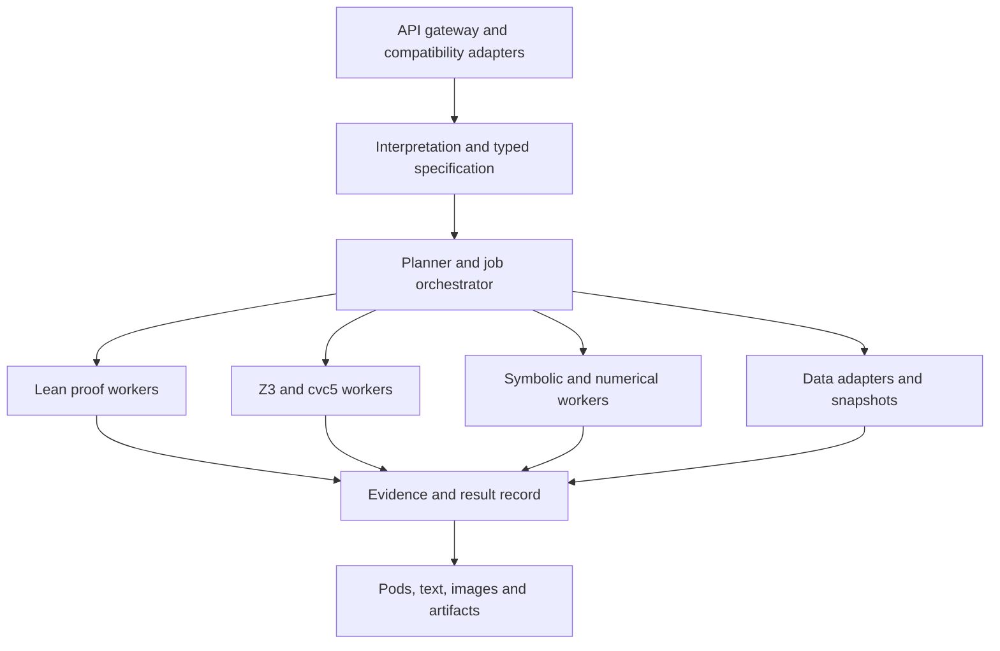

# Open Computational Knowledge and Proof Service

Implementation specification · 18 October 2026 · Design, not an implemented service

## 1. Objective

Build an independently hosted, open source computational knowledge service with Wolfram Alpha-style endpoint shapes and a natural-language-to-formal-verification core. Lean 4 checks formal proofs; Z3 searches constraints and counterexamples; optional cvc5/lean-smt reconstructs supported SMT proofs in Lean. SymPy, numerical libraries, units, and independently sourced data provide computational coverage beyond theorem proving.

Deliver the service families described below. Endpoint compatibility, supported mathematical domains, and data coverage are separate milestones. Never advertise full Wolfram Alpha equivalence merely because paths match. Clients must change the base URL and use our credentials. The service must not require Wolfram infrastructure or redistribute its answers or knowledgebase.

The essential distinction: Lean checks a formal statement under explicit assumptions. It does not certify that an LLM translated natural language correctly, or that empirical premises describe reality.

## 2. Prior decisions and existing projects

| Project | Role and decision |
|---|---|
| [Lean 4](https://github.com/leanprover/lean4) | Authoritative formal proof checker; pin compiler and dependencies |
| [Mathlib](https://github.com/leanprover-community/mathlib4) | Mathematical definitions, lemmas, and tactics; retrieve by pinned revision |
| [Z3](https://github.com/Z3Prover/z3) | Fast constraint solving and counterexample search; its answer alone is not Lean certification |
| [lean-smt](https://github.com/ufmg-smite/lean-smt) | Existing Lean tactic calling cvc5 and replaying proofs; residual proof obligations must be closed |
| [SymPy](https://www.sympy.org/) | Initial symbolic algebra/calculus engine |
| [SciPy](https://scipy.org/) | Numerical integration, optimization, and scientific algorithms |
| [Pint](https://pint.readthedocs.io/en/stable/) | Units, quantities, conversions, dimensional checks |
| [SymPy Gamma](https://github.com/sympy/sympy_gamma) | Reference for related computations and result presentation; audit deployment dependencies before reuse |
| [SageMath](https://github.com/sagemath/sage) | Optional broad mathematical worker, introduced when coverage requires it |
| [Mathics3](https://github.com/Mathics3/mathics-core) | Optional supported Wolfram Language syntax adapter; not complete Wolfram compatibility |
| [Qalculate](https://github.com/Qalculate/libqalculate) | Alternative calculator/units engine; add only when it fills a measured coverage gap |

Start with Z3 plus independent Lean proof generation. Keep a cvc5/lean-smt adapter for reconstructed proofs. Do not assume arbitrary Z3 proofs can be imported into Lean. The natural-language model, tactic search, and solver orchestration may be imperfect; certification depends on the checked artifact and its audited dependencies.

## 3. System architecture



Suggested implementation: Python/FastAPI gateway, Pydantic schemas, worker queue, PostgreSQL metadata, object storage for proofs and renderings, and optional Redis caching. For local development, SQLite and local object storage suffice. These are proposed engineering choices, not compatibility requirements.

All endpoints consume one canonical result record. Presentation adapters must never rerun reasoning with different assumptions. Cache identity includes normalized specification, source snapshots, engine revisions, model/prompt revision, precision, and requested proof policy. Tenant authorization is checked separately on every cached object and download.

## 4. Public endpoint compatibility map

The documented Wolfram paths below are reference contracts [W1–W8]. Host them on OUR base URL; retain paths, parameter spelling, and response families. Examples are our proposed behavior, not captured Wolfram responses. HTTPS is mandatory even where historical documentation shows HTTP.

| Service | Reference path on our host | Principal inputs | Output family | Internal mapping |
|---|---|---|---|---|
| Full Results [W1] | `GET /v2/query` | `appid`, `input`, `output` | XML by default; JSON option | Canonical record → pods |
| LLM [W2] | `GET /api/v1/llm-api` | `appid`, `input`, `maxchars` | LLM-oriented text | Interpretation, result, evidence, local artifact links |
| Simple [W3] | `GET /v1/simple` | `appid`, `i` | Single result image | Render canonical pods |
| Short Answers [W4] | `GET /v1/result` | `appid`, `i` | Plain text | Primary answer selector |
| Spoken Results [W5] | `GET /v1/spoken` | `appid`, `i` | Plain text in sentences | Speech-friendly formatter; not audio generation |
| Fast Query Recognizer [W6] | `GET /queryrecognizer/query.jsp` | `appid`, `i`, `mode`, `output` | XML/JSON | Capability classifier and entity/formula lookup |
| Summary Boxes [W7] | `GET /summaryboxes/v1/query` | `appid`, `path` | XHTML | Entity/property snapshot rendering |
| Instant Calculators [W8] | Recognizer discovery + Full Results evaluation | Formula descriptors and assumptions | Formula metadata then pods | Formula registry → validated evaluation |

Also provide `/api/v2/query` as a route alias because Wolfram documentation uses it in some examples. Instant Calculators is a workflow over existing endpoints, not an invented `/instant-calculators` route.

Public compatibility targets do not include internal Wolfram storage URLs. Returned image, continuation, and result links must reference our service. Generated tokens belong to our registry; accept our returned assumption and formula identifiers, without claiming equivalence to Wolfram's opaque catalog.

### 4.1 Compatibility parameters and behavior

Full Results target vocabulary: `format`, `includepodid`, `excludepodid`, `podtitle`, `podindex`, repeated `assumption`, and repeated `podstate`, in addition to the table above. Pod/subpod output includes plaintext and images; maintain stable IDs and positional order. Filtering include/exclude IDs together is invalid. Output serialization and per-pod content format are different switches. [W1]

Simple supports `layout`, `background`, `foreground`, `fontsize`, `width`, `units`, and `timeout`. It returns one static image rather than an interactive or asynchronous response. [W3]

Short and Spoken accept basic unit/timeout controls. A concise answer may be unavailable even when richer results exist. [W4–W5]

The LLM route uses `input`, not `i`, and documents `maxchars` with a default of 6800. It also supports an AppID via a bearer header. Start with text output; independently fixture any other claimed format. [W2]

Recognizer uses `mode=Default` or `Voice`; `output=json` selects JSON rather than XML. Acceptance estimates supported coverage, not mathematical truth or proof success. Its documented timing is milliseconds; do not reuse Full Results timing units blindly. [W6]

Implement supported location, units, precision, and timeout controls through a versioned parameter registry. Before implementing additional reference parameters or defaults, consult the linked docs and add a contract fixture. For unimplemented parameters, return a visible unsupported-feature outcome rather than silently dropping them. Advertise only fixture-tested parameters in `/v1/capabilities`.

### 4.2 Full Results example

```http
GET /v2/query?appid=LOCAL_KEY&input=integrate+x%5E2+from+0+to+3&output=json&format=plaintext
```

Illustrative supported subset:

```json
{
  "queryresult": {
    "success": true,
    "error": false,
    "numpods": 2,
    "pods": [
      {
        "title": "Input interpretation",
        "id": "Input",
        "position": 100,
        "numsubpods": 1,
        "subpods": [{"title": "", "plaintext": "Integral of x^2 from 0 to 3"}]
      },
      {
        "title": "Result",
        "id": "Result",
        "position": 200,
        "primary": true,
        "numsubpods": 1,
        "subpods": [{"title": "", "plaintext": "9"}]
      }
    ]
  }
}
```

The XML serializer emits a `queryresult` root, `pod` elements, and `subpod`/`plaintext` children for the same result. Use proper serializers and escaping, not string interpolation. This example is a design fixture; exact reference typing, optional attributes, error variants, and nested collections require endpoint-specific golden fixtures. Query processing success is never synonymous with proof success.

### 4.3 Short, spoken, image, and LLM examples

```http
GET /v1/result?appid=LOCAL_KEY&i=integrate+x%5E2+from+0+to+3
GET /v1/spoken?appid=LOCAL_KEY&i=integrate+x%5E2+from+0+to+3
GET /v1/simple?appid=LOCAL_KEY&i=integrate+x%5E2+from+0+to+3&width=500
GET /api/v1/llm-api?appid=LOCAL_KEY&input=prove+every+integer+x+greater+than+5+has+2*x+greater+than+10&maxchars=1500
```

Our proposed short body is `9`; spoken body is `The integral of x squared from zero to three is nine.` Simple produces actual image bytes with matching MIME type. LLM text includes the formal interpretation and qualification `Lean checked the formalized statement under the listed assumptions` only after proof acceptance. Reserve space for qualification before truncating explanatory material.

### 4.4 Discovery, summary boxes, and calculator workflow

Recognizer XML design fixture:

```xml
<queryrecognizer version="0.2">
  <query i="France" accepted="true" domain="countries">
    <summarybox path="countries/france"/>
  </query>
</queryrecognizer>
```

The path is locally allocated. A subsequent `/summaryboxes/v1/query?appid=LOCAL_KEY&path=countries/france` returns sanitized XHTML with source/date information. Preserve reference layout hooks such as `wasb` where needed by client fixtures. Never use proprietary example identifiers as our entity database. [W6–W7]

For calculators: register formula name, variable types, units, valid ranges, defaults, and possible output variables. Recognizer exposes `formula`/`variable` descriptors; evaluation goes through `/v2/query` using returned formula-selection and variable-assignment assumption tokens. Reproduce the documented FormulaSelect/FormulaVariable token grammar for registered formulas and fixture it before declaring compatibility. [W8]

### 4.5 Errors, continuation, and compatibility maturity

Reference simple-result families document missing-input 400 and unanswerable-query 501 behaviors; LLM documents missing/invalid AppID 403. Preserve reference behavior only where tested; do not assume every endpoint has identical authentication error bodies. [W2–W5]

Our service additionally defines authentication/rate-limiting, payload-size, deadline, and unsupported-feature responses in its OpenAPI contract. Keep a strict compatibility profile distinct from native API behavior. Full Results domain failures use documented-style envelopes when fixtures require them; native asynchronous submissions return 202 and a job URL.

Full Results includes asynchronous/drilldown capabilities [W1]. Implement continuation URLs we issue, with expiry and authorization, before claiming that feature. Never fetch arbitrary client-supplied continuation URLs. In phase one expose synchronous responses and honest timeouts; phase two adds resumable state and pod updates. Treat step-by-step derivations as an explicit capability: calculation steps, numerical traces, and formal proof traces are different artifacts.

## 5. Native verification and job endpoints

These are OUR extensions, not Wolfram endpoints. Keeping evidence here avoids breaking strict legacy parsers.

| Endpoint | Contract |
|---|---|
| `POST /v1/formalize` | Natural language → candidate typed specification and ambiguity list |
| `POST /v1/prove` | Specification or text → bounded proof job |
| `POST /v1/verify` | Statement and supplied Lean proof → isolated checking job |
| `POST /v1/counterexample` | Specification → bounded SMT search and witness validation |
| `GET /v1/jobs/{id}` | Current job, specification hash, results, remaining obligations |
| `DELETE /v1/jobs/{id}` | Cancel authorized unfinished work |
| `GET /v1/jobs/{id}/artifacts/{name}` | Authorized proof, SMT input, build manifest, or trace |
| `GET /v1/capabilities` | Actual domains, backends, compatibility profiles, limits |
| `GET /healthz`, `GET /readyz` | Liveness and backend readiness |

Require bearer authentication for native endpoints. Compatibility `appid` is our own API credential, never a Wolfram credential; redact query strings from logs. Derive tenant context from validated authentication, not request JSON.

Example native request:

```json
{
  "input": "For every integer x greater than 5, 2*x is greater than 10",
  "proof_policy": "lean_kernel",
  "budget": {"wall_seconds": 30, "max_attempts": 5}
}
```

Example completed job (illustrative):

```json
{
  "id": "job_example",
  "status": "completed",
  "outcome": "verified",
  "specification": {
    "variables": [{"name": "x", "sort": "Int"}],
    "assumptions": ["x > 5"],
    "claim": "2*x > 10",
    "quantification": "forall"
  },
  "assumption_consistency": "sat",
  "evidence": {
    "kind": "lean_kernel_checked",
    "proof_artifact": "/v1/jobs/job_example/artifacts/proof.lean",
    "axiom_audit": "passed",
    "environment_manifest": "/v1/jobs/job_example/artifacts/environment.json"
  },
  "qualification": "The formalized claim is checked; natural-language fidelity is a separate assessment."
}
```

The displayed string specification is for readability. Actual transport/storage must use a validated typed expression tree, not executable strings.

## 6. Formalization and proof protocol

1. Parse the request into candidate meanings. Extract domains, quantifiers, assumptions, units, and the goal.
2. Validate a restricted typed AST. Reject undeclared variables, unsupported operators, illegal coercions, and missing domain information that changes the claim.
3. Render the interpretation back to readable language and Lean. Materially different candidates yield `needs_clarification`; do not choose the easiest theorem to prove.
4. Check assumptions alone for consistency when supported. `unsat` means inconsistent premises, not a useful proof of the requested claim. `unknown` must remain visible.
5. Z3 checks assumptions AND NOT claim. `sat` gives a candidate counterexample, `unsat` establishes the encoded entailment according to that solver, `unknown` is inconclusive. Validate returned witnesses against original AST semantics.
6. Attempt Lean tactics and lemma retrieval. Optionally use cvc5 through lean-smt; close every residual goal. A Z3 timeout does not prevent an independent Lean proof attempt within the overall budget.
7. LLM repairs may change proof attempts, never silently change the frozen statement. Specification changes invalidate prior evidence and start a new specification revision.
8. Recheck the completed artifact in a clean pinned environment. Reject `sorry`, `admit`, unexpected axioms, and dependencies outside policy. Inspect transitive axiom dependencies, not just textual spellings.
9. Persist statement/proof hashes, complete dependency manifest, admitted axiom policy, source revisions, commands, resource usage, and outcome.

AST must distinguish Int/Nat/Real/Rational/Bool and bit-vector sorts. Encode division, natural-number subtraction, overflow, coercions, empty domains, and quantifier scope explicitly. Start with quantifier-free linear integer/rational arithmetic; universal implications over free arithmetic variables are checked through counterexample search. Add nonlinear, quantified, and other theories only with dedicated translation tests.

Lean example:

```lean
import Mathlib

theorem double_gt_ten (x : ℤ) (h : x > 5) : 2 * x > 10 := by
  omega

#print axioms double_gt_ten
```

This is a proposed smoke-test artifact, not a proof checked while writing this document. Lean's default classical axioms and any additional proof mechanisms require an explicit deployment allowlist. Reject externally asserted truth such as a custom `axiom claim : ...`. A clean compiler exit alone is insufficient if the file defines a different theorem or admits its proof: verify the expected declaration's actual type and dependencies.

## 7. Results and evidence semantics

Keep job execution state separate from mathematical outcome.

| Outcome/evidence | Permitted interpretation |
|---|---|
| `verified` + `lean_kernel_checked` | Expected formal theorem checked under audited assumptions/axioms |
| `solver_unsat` | Solver found no satisfying counterexample; not yet Lean-certified |
| `counterexample_found` | Validated witness refutes the encoded claim under its assumptions |
| `symbolic_result` | CAS produced a symbolic result with domain conditions |
| `numerical_result` | Approximate calculation with precision/tolerance metadata |
| `sourced_fact` | Assertion attributed to a versioned external record |
| `inconsistent_assumptions` | Premises contradict one another in the checked encoding |
| `needs_clarification` | Formal meaning is materially ambiguous |
| `unknown`, `proof_not_found`, `timeout`, `unsupported`, `error` | No theorem truth conclusion follows |

Pods proposed for our own proof queries: `Input`, `Result`, `Assumptions`, `FormalStatement`, `ProofStatus`, `Counterexample`, `Sources`, and `Diagnostics`. These proof-specific IDs are extensions, not claims about Wolfram's catalog. A verified proof of a model conditional on measured inputs does not verify those measurements or the model's suitability.

## 8. Data sources and mathematical knowledge

Use three distinct stores: theorem/library knowledge, empirical data, and reproducible computation artifacts. Retrieval assists interpretation or lemma discovery; retrieved text never becomes a theorem without an explicit premise or proof.

| Source | Coverage | Acquisition and use | Phase |
|---|---|---|---|
| Mathlib [E2] | Formal mathematics | Pinned git checkout, declaration index, local lemma retrieval | 1 |
| Project proof corpus | Previously accepted proofs | Store proof/specification/environment hashes; recheck on upgrades | 1 |
| Wikidata [D1] | Entities, identifiers, linked properties | Entity JSON/SPARQL; cache revisions; CC0 structured data | 2 |
| NIST/CODATA [D2] | Physical constants | Versioned curated snapshots with uncertainties and exactness | 2 |
| World Bank Indicators [D3] | Country time series and indicator metadata | Versioned API imports; retain indicator definition and observation period | 2 |
| PubChem PUG REST [D4] | Chemical identifiers and properties | Record source identifiers and property provenance | 3 |
| Open-Meteo [D5] | Forecast/weather model output | Optional adapter; keep model/run times, attribution, and service terms | 3 |
| User datasets | Tenant-specific facts and models | Explicit imports, schema validation, isolated permissions | 2 |

These are candidate independent sources, not an already populated replacement database. NIST values may be measured or exact; preserve that distinction. World Bank indicators are not necessarily current-year observations. PubChem records may aggregate third-party contributions: record attribution/reuse conditions rather than assuming uniform unrestricted rights. Open-Meteo's data licensing and hosted commercial access conditions are separate; its free hosted tier is described as noncommercial. [D2–D5]

Each fact needs: source URL, provider, entity/record ID, property definition, raw value, normalized value, unit, observation time, retrieval time, revision or snapshot hash, uncertainty, attribution/license metadata, and conflict/staleness state. Missing values remain missing. Refresh schedules are domain-specific; display the observation date rather than implying retrieval time is measurement time.

No vector database is required for initial mathematical checking. Introduce one only if lemma/entity retrieval quality justifies it; identifiers, schemas, provenance, and exact matching remain authoritative.

## 9. Isolation, operations, and reproducibility

Run untrusted Lean code, CAS jobs, and generated programs in a real isolation boundary with no secrets, no network, a read-only pinned dependency image, disposable writable storage, process limits, and CPU/memory/wall-clock caps. Lean files can execute elaborator/metaprogramming code; removing `eval` strings is not a sandbox. Separate data ingestion network access from proof workers.

Enforce tenant quotas and bounded output sizes; sanitize XHTML/SVG and disable external resource loading during rendering. Store confidential claims/proofs behind tenant authorization; use scoped expiring artifact links. Do not put private text in public URLs or shared result caches. Record metadata rather than full sensitive inputs by default.

Queue long searches; cancellation terminates the worker group. Cache dependency builds and warm workers, while keeping each job's state isolated. Most symbolic and proof workloads can begin on CPU; an optional local LLM has separate model/hardware requirements. Do not promise bounded proof completion for arbitrary mathematics.

Maintain lockfiles, container digests, Lean/Mathlib commits, SMT solver versions, AST/translator versions, and dataset hashes. Retain source licenses and dependency notices; select the service's distribution license after checking actual dependencies, especially optional GPL engines.

## 10. Repository layout

```text
gateway/                 auth, quotas, HTTP endpoints
compat/                  Wolfram-shaped route adapters and serializers
specification/           typed AST, validation, semantics, rendering
formalization/           model adapter, prompts, ambiguity handling
orchestrator/            jobs, bounded attempts, cancellation
workers/lean/            tactic search, artifact checks, axiom audit
workers/smt/             Z3, cvc5, witness validation
workers/symbolic/        SymPy and optional mathematical engines
workers/numeric/         SciPy and precision controls
knowledge/               provider adapters, provenance, snapshots
render/                  pods, text, XHTML, plots, result images
schemas/                 OpenAPI, JSON Schema, XML fixtures
tests/                   contracts, translation, proof acceptance, isolation
deploy/                  local compose and deployment manifests
```

## 11. Build order and acceptance gates

### Phase 1 — Proof service and core compatibility

Implement typed arithmetic specifications; formalize/prove/verify/counterexample jobs; Z3 plus independent Lean proof attempts; pinned Mathlib; basic SymPy and Pint operations. Expose Full Results XML/JSON, Short Answers, and LLM text for supported domains. Publish an explicit capabilities manifest.

Gate: independently replay a checked arithmetic proof; return a validated counterexample to a false claim; reject inconsistent premises as a meaningful proof result; reject admitted proofs; preserve `unknown` and timeouts. Verify a client can switch base URL and parse the supported response subset.

### Phase 2 — Presentation, discovery, and data

Add Simple images, Spoken text, recognizer, summaries, calculator registry, and versioned Wikidata/NIST/World Bank imports. Add declared pod filtering, assumption selection, formula controls, and asynchronous continuation. Proof qualification must survive every output adapter.

### Phase 3 — Broader reasoning and coverage

Evaluate lean-smt/cvc5 reconstruction; expand tested mathematical theories and data domains; add SageMath/Mathics/Qalculate only where needed. Implement additional reference parameters and detailed result states against fixtures. Publish compatibility and coverage reports separately.

Required test families: parsing/serialization contracts; Int versus Real semantic mismatch; division/overflow/quantifiers; contradictory assumptions; specification tampering; fake theorem names/types; unapproved axioms; counterexample replay; partial SMT reconstruction; cancellation; unauthorized artifact access; XML/XHTML escaping; provider outages/staleness; byte limits; clean proof replay after environment upgrades.

Seed adversarial claims include `every integer is even`, `sqrt(x^2)=x for all real x`, division by zero, natural subtraction, and an implication with contradictory premises. Benchmark formalization fidelity separately from solver success and proof acceptance. No score should reward silently weakening a claim.

## 12. Instructions for the implementing agent

Treat this document as the build specification. Implement a working vertical slice before expanding endpoint count. Keep a machine-readable feature matrix with states planned/implemented/fixture-tested. Never equate a route existing with full compatibility. Never label a solver result or numerical check as Lean verification. Freeze each formal statement before proof search. Preserve every unresolved obligation. Use independently sourced data and stable local identifiers. Include reproducible local startup instructions, representative curl calls, and an honest coverage report with the first release.

## 13. Source register

Public documentation reviewed 18 October 2026. Reference API descriptions are documented facts; architecture, local examples, native routes, phases, and acceptance policy are our design proposals. Links are the authoritative starting points for implementation-time validation; no third-party API calls or Lean builds were executed for this specification.

- W1: [Full Results API](https://products.wolframalpha.com/api/documentation/).
- W2: [LLM API](https://products.wolframalpha.com/llm-api/documentation).
- W3: [Simple API](https://products.wolframalpha.com/simple-api/documentation).
- W4: [Short Answers API](https://products.wolframalpha.com/short-answers-api/documentation).
- W5: [Spoken Results API](https://products.wolframalpha.com/spoken-results-api/documentation).
- W6: [Fast Query Recognizer](https://products.wolframalpha.com/query-recognizer/documentation).
- W7: [Summary Boxes](https://products.wolframalpha.com/summary-boxes-api/documentation).
- W8: [Instant Calculators](https://products.wolframalpha.com/instant-calculators-api/documentation).
- E1: [Lean reference and kernel model](https://lean-lang.org/doc/reference/latest/); [axiom tracking](https://lean-lang.org/doc/reference/latest/Axioms).
- E2: [Mathlib repository](https://github.com/leanprover-community/mathlib4).
- E3: [Z3 satisfiability and validity](https://microsoft.github.io/z3guide/programming/Z3%20Python/Introduction/).
- E4: [lean-smt reconstruction behavior](https://github.com/ufmg-smite/lean-smt).
- E5: Mathematical engine/project links in section 2.
- D1: [Wikidata data access](https://www.wikidata.org/wiki/Wikidata:Data_access/en).
- D2: [NIST fundamental constants](https://physics.nist.gov/cuu/Constants/).
- D3: [World Bank Indicators API](https://datahelpdesk.worldbank.org/knowledgebase/articles/889392).
- D4: [PubChem PUG REST](https://pubchem.ncbi.nlm.nih.gov/docs/pug-rest); [provider API paper](https://doi.org/10.1093/nar/gky294).
- D5: [Open-Meteo source](https://github.com/open-meteo/open-meteo), [pricing/access](https://open-meteo.com/en/pricing), [terms](https://open-meteo.com/en/terms).

## 14. Wolfram Language Compute compatibility slice

The initial API implementation also exposes `POST /api/cag/v1/WolframLanguageCompute` with the request fields `code`, `line`, `maxChars`, and `timeConstraint`, and the response fields `result`, `code`, `success`, and `uuid`. It accepts our configured API key in the `Authorization` header, either as a raw value or as a bearer token. Responses add an `evidence` object with the generated Lean source, its SHA-256, and the axiom audit.

This route is an adapter to our local Lean worker; it does not evaluate arbitrary Wolfram Language and does not call Wolfram services. The first allowlisted expressions are `Sin[Pi]`, `TrigExpand@Sin[2x]`, and `Integrate[x, {x, a, b}]` with integer bounds. Every successful result requires a kernel-checked proof. Graphics, `FreeformPrompt`, curated data lookups, and any other syntax return an explicit unsupported response. The documented 60-second input maximum is accepted, while the current worker limit is 30 seconds and is returned in evidence.
